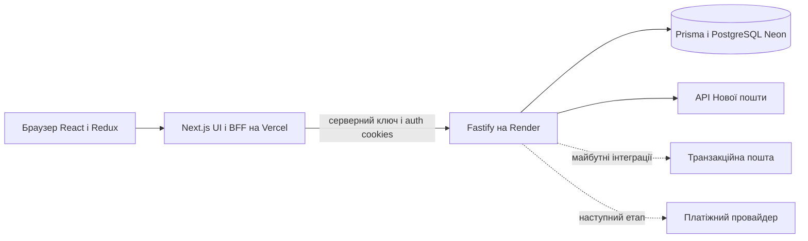

# Аудит поточного стану Coffeo

Дата: 24 листопада 2026 року. Ціль першого запуску, підтверджена власником: Україна, UAH, Нова пошта, оплата при отриманні. Онлайн-оплата — окремий наступний етап.

Coffeo має робочу основу магазину, але ще не готовий до приймання реальних замовлень без ручного втручання розробника. Основні блокери — ціни й залишки, повторне оформлення, обробка замовлень менеджером, доставка, залежності та поведінка під час збоїв. Переписування Next.js/Fastify або перенесення в monorepo для завершення цих задач не потрібне.

Покрокове виконання: [IMPLEMENTATION_PLAN_UA.md](IMPLEMENTATION_PLAN_UA.md).

Оновлення після аудиту, 24.11.2026: шлях підвищення ролі з A02 виправлено окремим C0.1 — [коміт API](https://github.com/LeoFom/fastify-prisma-app/commit/2f9dcb3c479433eddc309c9802852cf49e173ae3), [CI success](https://github.com/LeoFom/fastify-prisma-app/actions/runs/45457764526). Публічна реєстрація тепер завжди Customer, unknown fields дають 400. Решта таблиць нижче описує початковий стан аудиту; інші findings цим патчем не закриті.

Наступне оновлення C0.2, 24.11.2026: пакетну частину A01 виправлено — [API security report](https://github.com/LeoFom/fastify-prisma-app/blob/c5cf7a758dd483689acde506c0c32cc9766dbff0/docs/security/C0_2_DEPENDENCY_UPDATE.md), [frontend report](security/C0_2_DEPENDENCY_UPDATE.md). Поточний повний npm audit включно з dev має 0 findings в обох repo; CI та Render/Vercel production пройшли перевірку. Це не закриває решту доменних/експлуатаційних findings і не підтверджує ротацію історичних секретів.

Оновлення C0.4, 24.11.2026: додані Coffeo AGENTS, API lint, поступовий Prettier gate та CI-перевірки. Старі project-description позначені historical. Власник підтвердив відкликання Nodemailer; решта рішень і межі перевірки — у [C0.3](https://github.com/LeoFom/fastify-prisma-app/blob/dev/docs/security/C0_3_STATUS_UA.md). [Звіт C0.4](C0_4_RULES_AND_CI_UA.md) містить локальні результати; початкові findings нижче збережені як історія аудиту.

## Межі та докази перевірки

Перевірено поточні `dev` на GitHub:

- [Фронтенд e815c24](https://github.com/LeoFom/coffee-shop/tree/e815c24fd86889e4df384719cb24e8af1f0c9be0).
- [API bfa8c83](https://github.com/LeoFom/fastify-prisma-app/tree/bfa8c8397902618417a96c1bbbe6e1cc7ab39e56).
- Публічний сайт: [coffeo-shop-one.vercel.app](https://coffeo-shop-one.vercel.app).

Розглянуто маршрути App Router і BFF, клієнтські компоненти, Redux/Context, усі шість модулів API, Prisma-схему й міграції, інтеграцію Нової пошти, CI та конфігурацію розгортання. Старі `project-description/PROJECT.md`, `BUGS.md`, `ROADMAP.md` зіставлено з кодом. Використано правила `auditing-security`, `reviewing-code`, `web-design-guidelines` та рекомендації `create-a-backend`.

Під час цього аудиту код магазину, хмарні налаштування та записи production-БД не змінювалися. Створено лише документи й локальні діагностичні скрипти. Перевірки HTTP були читанням даних; нові покупці та замовлення на публічному сайті не створювалися.

Статуси нижче означають наявність і зв'язність коду. Вони не замінюють приймання всіх бізнес-сценаріїв на заповненому каталозі.

## Архітектура, яку варто зберегти

У браузер не передаються DATABASE_URL та INTERNAL_API_KEY. Браузер звертається до `/api/*` того самого origin; Next пересилає запити до Fastify. Для змін товарів Fastify додатково перевіряє поточну роль із БД. Внутрішній ключ обмежує прямий доступ до Render, але публічні BFF-маршрути реєстрації й входу все одно потребують захисту від зловживань.

Бекенд уже розділений на routes → controller → service → repository. Транзакція створення замовлення та знімки його товарних позицій є правильною основою. PostgreSQL лишається джерелом правди для покупців, кошиків і замовлень. Клієнтський стан має бути відновлюваним відображенням сервера.

## Що вже реалізовано

| Область                               | Фактичний стан                                                                                                 | Що ще обмежує готовність                                                                                              |
| ------------------------------------- | -------------------------------------------------------------------------------------------------------------- | --------------------------------------------------------------------------------------------------------------------- |
| Розгортання                           | Next.js на Vercel, Fastify на Render, окрема Neon; конфігурації Node 24 і серверних env                        | Free cold start; немає підтвердженого процесу відновлення та повного release-процесу                                  |
| Реєстрація і вхід                     | bcrypt cost 12; access/refresh JWT; три HttpOnly cookies; `/auth/me`, logout, refresh                          | Немає відновлення пароля, підтвердження email, rate limit; є дефекти життєвого циклу сесій                            |
| Авторизація                           | Customer/Admin; серверний admin guard на мутаціях товарів; захищені сторінки                                   | Залишився небезпечний альтернативний шлях призначення Admin через ADMIN_EMAIL                                         |
| Профіль                               | Власний профіль читається й редагується через BFF/API                                                          | Початкові імена демонстраційні; очищення телефону й використання профілю в checkout недопрацьовані                    |
| Каталог                               | GET списку, за ID і slug; реальні картки та додавання в кошик                                                  | На публічному сервері список зараз порожній; DTO й coffee details не узгоджені                                        |
| Фільтри                               | На клієнті працюють категорії, roast і сортування за ціною                                                     | Roast не надходить із поточного API; немає URL-стану, пошуку й пагінації                                              |
| Адмінка товарів                       | Створення й редагування базових полів; API має DELETE                                                          | UI Delete без обробника; додаткові поля форми не зберігаються; фільтри toolbar декоративні                            |
| Кошик                                 | Авторизований користувач; upsert, зміна кількості, видалення, перевірка власника                               | Ціну задає клієнт; немає stock limits, узгодженого quote і надійної синхронізації після входу/виходу                  |
| Checkout                              | Реальний POST замовлення, серверна ціна Product, знімки позицій, адреса, Payment, очищення кошика в транзакції | Немає ідемпотентності, перевірки залишків, бізнес-правил знижок і повної доставки                                     |
| Особисті замовлення                   | Список і GET одного власного замовлення; історія в кабінеті                                                    | Немає зручної сторінки деталей, tracking, скасування; адміністратор не має загальної черги                            |
| Нова пошта                            | Серверний адаптер пошуку міст/відділень; UI вибору доставки                                                    | Ключ не входив до початкового налаштування; інтеграція потребує перевірки, нормалізації, timeout і обробки помилок    |
| Головна                               | Дизайн, секції, посилання на Shop та auth                                                                      | Товари, акції й статистика демонстраційні; низка кнопок не має дії                                                    |
| Лояльність                            | Prisma-модель і оформлена сторінка                                                                             | Один MOCK_MEMBER для всіх, фіксовані 7/10; реального API та нарахувань немає                                          |
| Розсилки                              | Prisma-модель і форма на головній                                                                              | Немає endpoint, згоди/підтвердження, відписки та надсилання                                                           |
| Customers/Analytics/Activity/Settings | Елементи навігації dashboard                                                                                   | Частково coming soon, частково порожній вміст; операційних модулів немає                                              |
| Тести                                 | Один наскрізний API integration test із багатьма assertions; CI обох репозиторіїв                              | Браузерний тест не включено до repo CI; немає тестів конкуренції, залишків, session rotation, доставки та відновлення |

Застарілі B1–B5 у старому BUGS.md не слід механічно реалізовувати вдруге: модуль замовлень, lookup хешованого refresh, payload userId, admin guard і перевірка власника кошика вже є. Реєстрація, кількість/видалення кошика, фільтри, профіль і реальна історія замовлень також суттєво просунулися від старого опису. Секрети в історії, скидання пароля, частина моків і узгодження контрактів залишаються актуальними.

## Блокери першого запуску

P0 тут означає необхідну умову початку реальних продажів, а не підтверджену експлуатацію вразливості.

| ID  | Проблема та наслідок                                                                                         | Доказ                                                                                                                                                                                                                                                                                                                                                                                     | Потрібна зміна                                                                                                                                        |
| --- | ------------------------------------------------------------------------------------------------------------ | ----------------------------------------------------------------------------------------------------------------------------------------------------------------------------------------------------------------------------------------------------------------------------------------------------------------------------------------------------------------------------------------- | ----------------------------------------------------------------------------------------------------------------------------------------------------- |
| A01 | npm audit повідомляє high/critical advisories у залежностях                                                  | Фронт: 7 пакетів, з них 1 critical/5 high/1 moderate. API: 15, з них 1 critical/11 high/3 moderate; `--omit=dev`, 24.11.2026                                                                                                                                                                                                                                                              | Перевірити застосовність advisories; узгоджено оновити Next/React/ESLint та Fastify/JWT/Zod/Prisma, перевірити lockfiles і регресії                   |
| A02 | Реєстрація може призначити Admin за email без підтвердження власника, якщо задано ADMIN_EMAIL                | [auth.repository.ts:26](https://github.com/LeoFom/fastify-prisma-app/blob/bfa8c8397902618417a96c1bbbe6e1cc7ab39e56/src/modules/auth/auth.repository.ts#L26)                                                                                                                                                                                                                               | Публічна реєстрація завжди Customer; залишити контрольований bootstrap. Наявність ADMIN_EMAIL у поточному Render env цим аудитом не перевірялася      |
| A03 | CoffeeDetails, stock, знижка, currency та active flag із форми не зберігаються                               | [product.schema.ts](https://github.com/LeoFom/fastify-prisma-app/blob/bfa8c8397902618417a96c1bbbe6e1cc7ab39e56/src/modules/product/product.schema.ts), [ProductFormPanel](../components/dashboard/products/ProductFormPanel.tsx)                                                                                                                                                          | Єдиний DTO, вкладена транзакційна робота з CoffeeDetails; читання include; належна валідація й тести збереження                                       |
| A04 | Можна оформити неактивний товар з нульовим залишком; stock не зменшується                                    | [order.repository.ts:54](https://github.com/LeoFom/fastify-prisma-app/blob/bfa8c8397902618417a96c1bbbe6e1cc7ab39e56/src/modules/order/order.repository.ts#L54)                                                                                                                                                                                                                            | Серверна перевірка active/stock, атомарне резервування/списання й одноразове повернення залишку при скасуванні                                        |
| A05 | Немає єдиної грошової моделі: client priceAtAdding, автоматична member-знижка всім, USD і різні формули UI   | [cart.repository.ts:19](https://github.com/LeoFom/fastify-prisma-app/blob/bfa8c8397902618417a96c1bbbe6e1cc7ab39e56/src/modules/cart/cart.repository.ts#L19), [order.repository.ts:74](https://github.com/LeoFom/fastify-prisma-app/blob/bfa8c8397902618417a96c1bbbe6e1cc7ab39e56/src/modules/order/order.repository.ts#L74), [ProductInfo](../components/shop/product/ProductInfo.tsx)    | UAH; quote із сервера; суми в копійках або послідовна Decimal-арифметика; знижки лише за визначеним правилом; підтвердження зміни суми перед покупкою |
| A06 | Транзакція не гарантує одноразове замовлення при одночасних запитах; очищаються всі рядки кошика користувача | [order.repository.ts:130](https://github.com/LeoFom/fastify-prisma-app/blob/bfa8c8397902618417a96c1bbbe6e1cc7ab39e56/src/modules/order/order.repository.ts#L130)                                                                                                                                                                                                                          | Ідемпотентний ключ із unique constraint, контроль ревізії/блокування кошика, захист від конкурентного checkout; не видаляти пізніше додані позиції    |
| A07 | Менеджер не може отримати всі замовлення, підтвердити/відправити/закрити їх                                  | [order.routes.ts](https://github.com/LeoFom/fastify-prisma-app/blob/bfa8c8397902618417a96c1bbbe6e1cc7ab39e56/src/modules/order/order.routes.ts)                                                                                                                                                                                                                                           | Admin API + UI, дозволені переходи станів, журнал змін, незалежне підтвердження COD-оплати й доставка                                                 |
| A08 | Нова пошта ще не є завершеним способом оформлення доставки                                                   | [nova-poshta.repository.ts](https://github.com/LeoFom/fastify-prisma-app/blob/bfa8c8397902618417a96c1bbbe6e1cc7ab39e56/src/modules/nova-poshta/nova-poshta.repository.ts), [DeliverySection](../components/checkout/DeliverySection.tsx), [order.mapper.ts](https://github.com/LeoFom/fastify-prisma-app/blob/bfa8c8397902618417a96c1bbbe6e1cc7ab39e56/src/modules/order/order.mapper.ts) | Зберігати delivery method/cityRef/warehouseRef окремими полями; перевіряти відповідність; погодити оплату доставки; додати ручну ТТН та tracking      |
| A09 | UI пропонує онлайн-оплату/переказ, хоча платіжної інтеграції немає; shippingAmount завжди 0                  | [PaymentSection](../components/checkout/PaymentSection.tsx), [order.mapper.ts](https://github.com/LeoFom/fastify-prisma-app/blob/bfa8c8397902618417a96c1bbbe6e1cc7ab39e56/src/modules/order/order.mapper.ts)                                                                                                                                                                              | Для запуску дозволити лише COD і на сервері, і в UI. Пояснити, хто й коли сплачує доставку; 0 не має означати обіцянку безкоштовної доставки          |

Важливе уточнення A05: підміна priceAtAdding зараз спотворює кошик і показаний підсумок, але checkout бере актуальну ціну з Product. Тест уже перевіряє цей захист. Проблема — розбіжність підтвердженої користувачем і фактично записаної суми, а не доведене придбання за довільною клієнтською ціною.

A06 — висновок із коду та стандартного сценарію паралельних запитів; реальний конкурентний тест PostgreSQL у цьому аудиті не запускався. Проста послідовна повторна покупка після очищення кошика повертає помилку порожнього кошика, але не відновлює відповідь на успішний запит, якщо клієнт її втратив.

## Інші необхідні доробки

| ID  | Прогалина                                                                                                                                 | Рішення                                                                                                                                                          |
| --- | ----------------------------------------------------------------------------------------------------------------------------------------- | ---------------------------------------------------------------------------------------------------------------------------------------------------------------- |
| A10 | Помилка API перетворюється на `[]`/null: порожній магазин, порожня історія або перенаправлення на login                                   | Типізувати 401/403/404/409/422/429/503; окремі error/empty/loading; повтор запиту без втрати введених даних                                                      |
| A11 | Refresh JWT без унікального jti; повторний login у ту саму секунду може отримати той самий token/hash; rotation delete/create не атомарна | Унікальна сесія, атомарна ротація, перевірка expiresAt/власника, визначена поведінка паралельного refresh, очищення прострочених сесій                           |
| A12 | Logout не очищає Redux cart; Header читає кошик тільки при монтуванні; Context і auth-флаг Redux дублюються                               | Один auth-контракт, скидання користувацьких даних на виході/зміні акаунта, завантаження кошика після входу, коректний стан при невдалому logout                  |
| A13 | Продукти з Prisma Decimal приходять як JSON-рядки, але ProductsType вимагає number; discount ≠ memberDiscountPercent                      | Серверний serializer/DTO, runtime-перевірка відповідей; одна модель цін у таблиці, картках, кошику й checkout. Інакше середня ціна в ProductStats може стати NaN |
| A14 | API списку товарів не обмежує isActive і не включає CoffeeDetails; немає пагінації                                                        | Окремий публічний список активних товарів, admin список, пошук, обмежений page size, серверні фільтри; URL-стан UI                                               |
| A15 | Головна показує вигадані товари, продажі, акції; пошук, wishlist, subscribe і частина вкладок не працюють                                 | Замінити на реальні дані й дії; прибрати непідключені можливості з першого релізу; реальний пошук каталогу                                                       |
| A16 | На 390 px немає меню; доступні лише логотип і дві іконки. У кошика немає dialog semantics, Escape/focus trap, у кнопок немає назв         | Мобільна навігація, доступний drawer/dialog, label/focus/keyboard стани, управління фокусом, доступні пошукові списки й помилки форм                             |
| A17 | Неіснуючий товар повертає 200; robots.txt/sitemap.xml відсутні; metadata переважно спільна                                                | Справжній notFound 404, окрема 503-помилка; canonical production origin, product metadata/OG/JSON-LD, sitemap і robots, noindex приватних сторінок               |
| A18 | Немає reset/change password та транзакційних повідомлень                                                                                  | Поштовий адаптер, одноразовий хешований reset-token із TTL, нейтральні відповіді, rate limit, відкликання сесій; підтвердження замовлення й зміни статусу        |
| A19 | Поле courier не містить обов'язкового міста; checkout не підставляє профіль; очищення телефону профілю не надсилається                    | Для першого релізу залишити погоджені способи Нової пошти; допрацювати поля/валідацію; відрізняти omitted від null при очищенні профілю                          |
| A20 | Продажі залежать від Free cold start, квот, резервного копіювання й процедури міграцій                                                    | Контрольований пілот; backup/restore на ізольованій БД, error monitoring, план квот/інцидентів; staging і безпечні релізи                                        |
| A21 | Order.user має onDelete Cascade                                                                                                           | Поки API видалення акаунта немає — це майбутній ризик. Перед його додаванням зберегти замовлення/аудит і визначити анонімізацію та строки зберігання             |
| A22 | Membership, newsletter, activity переважно лише схема; QR однаковий для всіх                                                              | Приховати в першому релізі; потім окремі API, журнали нарахувань, staff-доступ, unsubscribe і правила згоди                                                      |
| A23 | Dashboard змішує кабінет покупця з панеллю менеджера; Total Spent включає Pending і Cancelled                                             | Розділити навігацію та права; визначити показники за payment/order status; лише реальні обчислення                                                               |
| A24 | Старі інструкції, legacy Task, дублікати checkout/типів; немає API lint/форматування й повного контракту API                              | Оновити документацію, OpenAPI/контракт, AGENTS для Coffeo, ESLint/formatter та CI; видаляти legacy таблиці тільки окремою перевіреною міграцією                  |

Нормальний silent refresh через Route Handler може переслати Set-Cookie браузеру. Прямі RSC-виклики getUser читають відповідь Fastify, але не встановлюють оновлену cookie браузеру. Цю відмінність треба врахувати під час доробки сесій; не слід додавати запис cookies довільно в Server Component.

Реєстрація зараз створює користувача й профіль двома незалежними запитами, не нормалізує регістр email і допускає пароль від 6 символів. Потрібні атомарне створення, єдина нормалізація email та погоджені обмеження пароля з урахуванням byte-limit bcrypt. Незнайдений товар/профіль і деякі Prisma-конфлікти зараз стають 500 замість доменної відповіді. Контролери місцями логують сирі об'єкти помилок/відповідей; redaction headers не очищає довільні console.log.

## Перевірки 24 листопада

| Перевірка                                                      | Результат                                                                                                                                  |
| -------------------------------------------------------------- | ------------------------------------------------------------------------------------------------------------------------------------------ |
| Frontend npm run lint                                          | Успішно                                                                                                                                    |
| Frontend npm run typecheck                                     | Успішно, включно з next typegen                                                                                                            |
| Backend npm run typecheck                                      | Успішно                                                                                                                                    |
| npm audit --omit=dev                                           | Виконано для двох lockfiles; exit 1 через advisories, не через помилку з'єднання                                                           |
| Браузер: home/shop/login/checkout                              | HTTP 200, необроблених pageerror не зафіксовано                                                                                            |
| Перший відкритий Shop                                          | Приблизно 37,5 с у цьому одиничному вимірі; це не навантажувальний benchmark                                                               |
| GET /api/products                                              | 200, порожній масив                                                                                                                        |
| GET /api/auth/me без сесії                                     | Очікуваний 401                                                                                                                             |
| Неіснуючий slug                                                | 200 замість 404 — підтверджений дефект                                                                                                     |
| robots.txt і sitemap.xml                                       | 404                                                                                                                                        |
| Кошик                                                          | 0 dialog elements; Escape не закриває drawer                                                                                               |
| Головна                                                        | 20 посилань href=#; демонстраційний Hair blender присутній                                                                                 |
| Мобільний header, 390 px                                       | Видиме посилання лише на головну; іконки Search/Cart без доступних назв                                                                    |
| Ізольований запуск OrderRepository із підставленою транзакцією | Підтверджено приймання inactive/zero-stock товару, member discount без membership lookup, змішування USD/EUR як USD                        |
| Ізольований запуск CartRepository                              | Підтверджено збереження клієнтського priceAtAdding, включно з від'ємним значенням на рівні repository                                      |
| Реальна Zod-схема Product                                      | Підтверджено відкидання coffeeDetails/stock/discount/currency/isActive при створенні                                                       |
| Детермінізм JWT                                                | Однакові payload/iat дають однакові refresh JWT; це перевірка властивості генерації, не повний concurrent-login тест                       |
| Останній GitHub CI API                                         | [success, 19.11.2026](https://github.com/LeoFom/fastify-prisma-app/actions/runs/44527358021), поточний commit; міграції й integration test |
| Останній GitHub CI web                                         | [success, 19.11.2026](https://github.com/LeoFom/coffee-shop/actions/runs/44528274288), поточний commit; lint/typecheck/build               |

Під час цього аудиту production build, CI, DB-міграції й DB integration test заново не запускалися: код не змінювався. Підтверджено наявні успішні прогони; вони не зараховуються як нові тести 24.11. Нова перевірка auth/cart/order із записами production не проводилася; попередня браузерна перевірка такого потоку виконувалася 19.11 на окремій тестовій БД. Реальні Нова пошта, пошта, платіжний провайдер, concurrency і restore потребують окремого приймання.

Звіт npm — кількість вразливих пакетів/агрегатів, не число незалежних підтверджених атак. Наприклад, RSA-specific advisory fast-jwt не доводить уразливість поточної HMAC-конфігурації; залежності Prisma CLI й mail helper мають інший шлях виконання, ніж публічний checkout. `npm audit fix --force` без аналізу не є планом виправлення. Рекомендовані registry версії треба повторно звірити на дату оновлення.

## Секрети та експлуатаційні обмеження

Файл `src/config/env.ts` усе ще доступний у legacy main бекенду; його значення тут навмисно не наведені. У dev файл видалений. Факт відкликання історичних MongoDB/поштових credentials власником не підтверджений. Потрібна ротація в сервісах, а не лише видалення з Git. Вузький пошук типових credential patterns у доступних tracked source-файлах dev не знайшов нових збігів; це не повний secret-scanning усієї історії.

Render Free засинає після 15 хв простою; старт наступного запиту може тривати близько хвилини. Файли на диску Free-сервісу не підходять для постійного зберігання фотографій або копій БД; 750 годин спільні для workspace. Render прямо позиціонує цей режим для тестування/хобі, а не production. Це матеріальне обмеження доступності магазину. [Render Free](https://render.com/docs/free)

Neon Free має 100 CU-hours, 1 GB PostgreSQL і до 6 годин instant restore в межах ліміту історії змін. Це не замінює незалежний довготривалий backup. План відновлення має бути перевірений до зберігання реальних замовлень. [Neon plans](https://neon.com/docs/introduction/plans)

У поточних Vercel Fair Use Guidelines від 12.11.2026 ecommerce наведений серед прикладів fair use; старі пошукові snippets про non-commercial не використані як чинна вимога. Перед продажами перевірити фактичний тариф/квоти акаунта та актуальні умови, не змінюючи тариф автоматично. [Vercel Fair Use](https://vercel.com/docs/limits/fair-use-guidelines)

## Рекомендація

Спочатку завершити надійне оформлення й обробку COD-замовлення та підготувати заповнений каталог. Зберегти чинні Next.js, Fastify, Prisma й PostgreSQL. Не додавати мікросервіси, Redis, інший auth-провайдер або платіжну систему до усунення описаних блокерів. Мінімальний робочий реліз і повний розвиток лояльності/маркетингу мають окремі критерії в плані.
